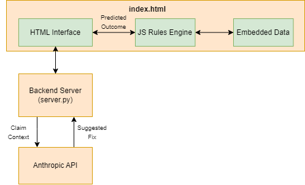
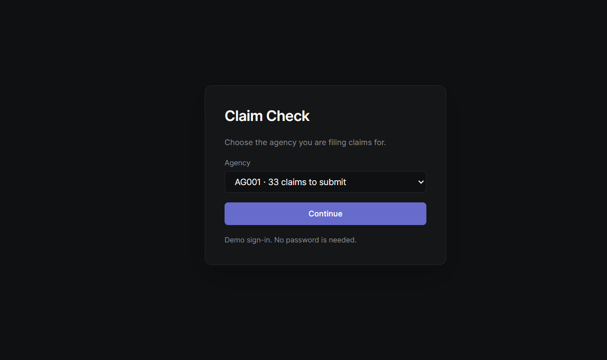
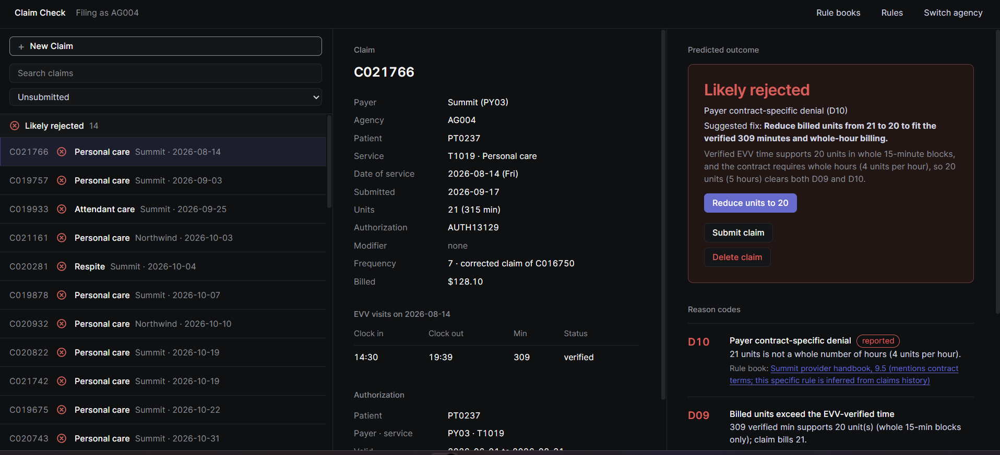

## System Design 

### Deterministic rules engine
The payee rules are codified into logic to predict whether claims are likely to be accepted in a deterministic fashion. Claims are matched against EVV records and authorisations. Rule details are given in HOW_IT_WORKS.md.

### App interface 
You can log in as a specific agency to access the claims you need to process. The idea is that this would be connected such that users could submit real claims via the interface. A list of claims is in the left hand side of the screen, filtered with the likely rejected claims first. These are then sorted by the oldest claims first, as these are the highest priority to submit. 

When you select each claim, it gives details of the specific claim alongside the EVV record and authorizations so users can trace it.

On the right hand side, it shows the prediction (likely accepted/rejected) of the claim outcome. Beneath this, it shows the checks that the program performed. 

### AI Integration
AI is used to suggest a fix to a claim and creates a button to complete that requirement. e.g. If a claim is a duplicate, it suggests deleting the duplicate claim.

### System diagram:

## Frontend Design

### Login page
The login page allows you to select which agency you want to review claims on behalf of.

### Claim review page

This page allows you to click through different claims, review their details and select whether you want to submit them.

For claims that are likely to be rejected, it shows why and a suggested fix (generated by AI). The suggested fix can be quickly implemented with a button generated.

